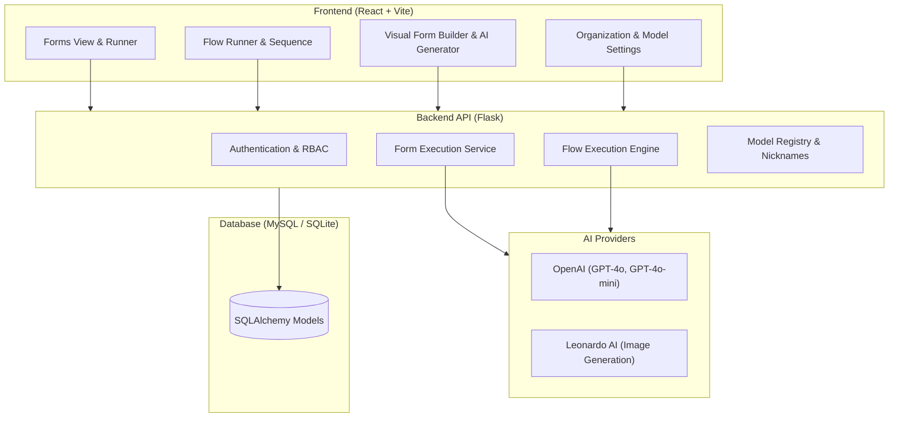
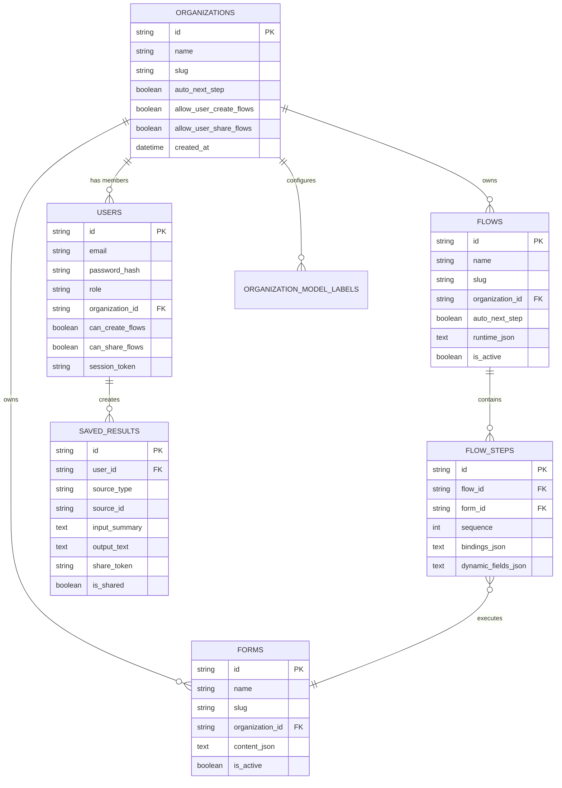

# PromptFlow — System Architecture & Technical Documentation

> **Version:** 2.1.0  
> **Target Audience:** Developers, Administrators, Solution Architects, and Product Teams  
> **Last Updated:** November 2026

---

## 1. Executive Summary

**PromptFlow** is an enterprise-grade AI workflow orchestration platform that converts reusable AI prompts into guided interactive forms and multi-step sequential workflows. 

Instead of ad-hoc prompt engineering in chat windows, PromptFlow provides organizations with:
- **Reusable Prompt Forms**: Schema-validated forms with typed inputs (text, dropdowns, checkboxes, multi-select, dates).
- **Multi-Step Workflows (Flows)**: Ordered sequences where outputs from preceding steps feed into subsequent steps as context or dynamic choices.
- **Organization-Level Governance**: Role-based access control, per-organization AI model nicknaming, flow-sharing permissions, and auto-progression settings.
- **Rich Result Retention & Distribution**: Output rendering in formatted markdown/rich text, document exports (DOCX, Markdown, CSV), and secure link-based sharing.



---

## 2. System Architecture

The application is architected as a decoupled client-server web application:

### 2.1 Backend Architecture
- **Framework**: Python 3.10+ / Flask
- **ORM & Migrations**: SQLAlchemy with Flask-Migrate (Alembic)
- **Database Support**: MySQL 8.x / MariaDB (XAMPP for local development) and SQLite
- **AI Execution Engine**: LangChain & OpenAI API SDK
- **Authentication**: Session token authentication with cookie and bearer header fallback
- **Role Hierarchy**:
  - `superadmin`: Global platform administrator; manages organizations, creates global templates, views system diagnostics.
  - `admin` (Org Admin): Organization administrator; invites/manages members, configures org-wide permissions, sets model nicknames, manages org forms and flows.
  - `member` (User): Runs assigned forms and flows; can create or share flows if granted permission by organization policies.

### 2.2 Frontend Architecture
- **Framework**: React 18, TypeScript
- **Build System**: Vite 6.x
- **Styling**: Tailwind CSS with custom Design Tokens and CSS variables
- **Component Primitives**: Radix UI (Dialog, DropdownMenu, Accordion, Progress, Select, Tabs)
- **State & Utilities**: Custom hooks for authentication (`authService`), model favoriting (`useFavoriteModels`), and activity logging (`logActivity`).
- **Markdown & Output Formatting**: `react-markdown` with customized GFM element rendering and `result-formatter.ts`.

---

## 3. Database Schema & Data Models



### Key Entity Specifications:
1. **`organizations`**:
   - `auto_next_step` *(Boolean)*: Organization default setting indicating whether multi-step flows advance automatically upon step completion.
   - `allow_user_create_flows` *(Boolean)*: Organization-level default permitting standard members to create flows.
   - `allow_user_share_flows` *(Boolean)*: Organization-level default permitting members to generate public share links for flows.
2. **`users`**:
   - `can_create_flows` *(Boolean, Nullable)*: Per-user permission override. If null, inherits `organization.allow_user_create_flows`.
   - `can_share_flows` *(Boolean, Nullable)*: Per-user permission override. If null, inherits `organization.allow_user_share_flows`.
3. **`flows`**:
   - `organization_id` *(String FK)*: Identifies the owning organization, or `NULL` for global templates.
   - `auto_next_step` *(Boolean, Nullable)*: Flow-specific override controlling automatic progression in the Flow Runner.
4. **`forms`**:
   - `content_json` *(JSON Text)*: Contains the complete schema defining fields, prompt templates, system instructions, and output contract schemas.

---

## 4. Core Features & Functional Modules

### 4.1 Reusable Prompt Forms
A **Form** packages an AI prompt into an end-user interface.
- **Input Field Types**: Single-line text, textarea, dropdown, radio buttons, single checkbox, multi-select, dates, and hidden values.
- **Prompt Interpolation**: Fields use double-bracket interpolation (`{{field_id}}`) to insert user input into system and user prompts.
- **Model Selection**: Users can choose any model enabled in the platform registry, with favorite pinning and organization nicknames displayed.
- **Result Output**: Clean rich text display with live toggle between formatted view and raw JSON output.

### 4.2 Guided Multi-Step Workflows (Flows)
A **Flow** chains multiple forms into an end-to-end operational pipeline.
- **Step Bindings & Context**: Intermediate steps pass previous step outputs via `input_bindings` (e.g. binding `step_1.output` to `step_2.context`).
- **Dynamic Options**: Downstream fields can derive their selectable options directly from an array generated in an earlier step (e.g. step 1 suggests 5 stretch targets, step 2 presents them as a dropdown).
- **Auto Next Step**:
  - If `auto_next_step` is enabled, the flow immediately advances to the next step once execution succeeds.
  - The manual "Next" button is automatically omitted when `auto_next_step` is active to prevent redundant clicks.
  - The "Previous" navigation remains available at all times.
- **Flow Complete Screen**:
  - Once the final step executes, the runner transitions to a dedicated **Flow Complete** view.
  - Displays the final generated output, an export dropdown, and a one-click "Save Result" button.
  - The step progress pills include **Flow Complete** as the culminating indicator.
- **Collapsible Post-Execution Details**:
  - Execution result panels are labeled **Details** and are collapsed by default with an expand/collapse toggle.
  - Step history is cleanly collapsed to avoid cluttering long runs.

### 4.3 Member Flow Creation & Storage Architecture
PromptFlow supports self-service workflow creation by standard organization members while maintaining tenant isolation and administrative oversight.

#### Permission Gating
Standard members can create individual flows when granted permission through either of two levels:
1. **Organization-Level Policy**: If an Org Admin enables **"Allow user to: Create flows"** (`organizations.allow_user_create_flows = true`), all members of that organization gain flow creation capabilities.
2. **Individual User Override**: Org Admins can explicitly check **"Can create flows"** (`users.can_create_flows = true`) on specific member accounts, allowing granular delegation without granting global creation rights.

When permitted, the `+ Create new flow` button appears on the user's Flows page (`/flows`).

#### Where & How Member Flows Are Stored
Member-created flows are persisted directly in the relational database across the following tables:
1. **`flows` Table**:
   - `id`: Unique UUID identifier.
   - `name` & `slug`: Flow title and URL-safe unique slug.
   - `organization_id`: Foreign key automatically set to the creating user's `current_user.organization_id`. This guarantees the workflow remains scoped exclusively to their organization.
   - `content_json`: Text/JSON containing the complete workflow schema:
     ```json
     {
       "id": "my-custom-flow",
       "name": "My Custom Flow",
       "version": "1.0",
       "runtime": { "mode": "guided", "default_review_required": true },
       "steps": [ ... ]
     }
     ```
   - `file_path`: Stored with the logical path reference `flows/<slug>.flow.json`.
   - `auto_next_step`: Boolean flag controlling auto-advance behavior for this specific flow.
   - `model_configuration`: JSON dictionary containing any default model, temperature, or provider overrides.
   - `is_active`: Set to `true` by default.
2. **`organization_flow_access` Table**:
   - When a member creates a flow via `POST /api/admin/flows`, the backend automatically inserts a record into `organization_flow_access(organization_id, flow_id)`.
   - This mapping authorizes all members belonging to that organization to view and run the new flow.
3. **`flow_form_steps` Table**:
   - Relates each step sequence number in the flow to its designated `form_id`, along with review and dynamic field bindings.

### 4.4 Form Builder & AI Generation Protection
The visual **Form Builder** supports both no-code authoring and direct JSON manipulation:
- **Visual & JSON Sync**: Changes made in the Visual Builder instantly synchronize with the raw JSON tab, and vice versa.
- **Overwrite Protection**:
  - Opening an existing form displays an informational status banner and requires clicking **Edit Form** before altering configuration.
  - The **Generate with AI** interface is tucked inside a designated collapsible warning accordion when editing existing forms.
  - Initiating an AI generation over an existing form prompts the user for explicit confirmation to prevent accidental loss of fields.

### 4.4 Organization Management & Model Nicknaming
- **Organization Settings**: Admins can configure the organization's name, slug, `auto_next_step` policy, and member flow permissions.
- **Model Nicknaming**: Centralized in the Models tab, organizations can assign friendly custom labels (e.g. nicknaming `gpt-4o` as *"Enterprise Copywriter"* or *"Compliance Auditor"*). All users in the organization see this nickname across runners and selectors.

### 4.5 Rich Markdown & Output Contract Formatting
- **Fenced Code Block Stripping**: LLM responses wrapped in outer fences (```` ```markdown ... ``` ````) are stripped cleanly so `ReactMarkdown` renders headers, lists, and tables as rich HTML rather than raw code boxes.
- **Output Contract Unpacking**: Single-key JSON payloads (e.g. `{ "tidbits": "..." }`) are automatically unpacked into pure readable markdown.
- **Multi-Line Header Preservation**: Keys containing markdown headers (`#`) or bullet lists (`-`) are separated onto dedicated lines, ensuring complete markdown parsing.

---

## 5. API Reference Guide

### 5.1 Authentication Endpoints
| Method | Endpoint | Description | Access |
|---|---|---|---|
| `POST` | `/api/auth/login` | Authenticate with email/password; returns user info & session token | Public |
| `GET` | `/api/auth/me` | Return active session details, user permissions, and org settings | Authenticated |
| `POST` | `/api/auth/logout` | Terminate session and invalidate session token | Authenticated |

### 5.2 Flow Execution & Management
| Method | Endpoint | Description | Access |
|---|---|---|---|
| `GET` | `/api/flows` | List all flows accessible to the user's organization | Authenticated |
| `GET` | `/api/flows/<id>` | Fetch flow details, ordered steps, and `auto_next_step` flag | Authenticated |
| `POST` | `/api/flows/<id>/execute` | Execute a single workflow step with provided values and context | Authenticated |
| `GET` | `/api/admin/flows` | List all flows (organization-filtered for Org Admins) | Admin+ |
| `POST` | `/api/admin/flows` | Create a new flow assigned to the user's organization | Admin / Permitted User |
| `PUT` | `/api/admin/flows/<id>` | Update flow configuration and step sequence | Admin+ |
| `DELETE` | `/api/admin/flows/<id>` | Delete a flow | Admin+ |

### 5.3 Form Management & AI Generation
| Method | Endpoint | Description | Access |
|---|---|---|---|
| `GET` | `/api/forms` | List all available forms | Authenticated |
| `GET` | `/api/forms/<id>` | Fetch form schema and field definitions | Authenticated |
| `POST` | `/api/forms/execute` | Execute a standalone form prompt | Authenticated |
| `POST` | `/api/forms/generate` | Use AI to suggest full form fields, prompt, and options from a prompt | Admin+ |
| `GET` | `/api/admin/forms` | List forms for administration | Admin+ |
| `POST` | `/api/admin/forms` | Create a new form schema | Admin+ |
| `PUT` | `/api/admin/forms/<id>` | Update an existing form schema | Admin+ |

### 5.4 Organization & User Administration
| Method | Endpoint | Description | Access |
|---|---|---|---|
| `GET` | `/api/organizations/<id>` | Get organization details and workflow permissions | Admin+ |
| `PUT` | `/api/organizations/<id>` | Update org settings (`auto_next_step`, `allow_user_create_flows`, etc.) | Admin+ |
| `GET` | `/api/users` | List organization users with permission flags | Admin+ |
| `PUT` | `/api/users/<id>` | Update user role or permissions (`can_create_flows`, `can_share_flows`) | Admin+ |
| `GET` | `/api/organization/model-labels` | Get active model nickname mappings for the organization | Authenticated |
| `POST` | `/api/organization/models/labels` | Set or remove custom organization model nickname | Admin+ |

### 5.5 Saved Results & Link Sharing
| Method | Endpoint | Description | Access |
|---|---|---|---|
| `GET` | `/api/saved-results` | Search and filter saved results | Authenticated |
| `POST` | `/api/saved-results` | Archive a form or workflow execution output | Authenticated |
| `POST` | `/api/saved-results/<id>/share` | Generate or toggle public read-only share link | Authenticated |
| `GET` | `/api/shared/results/<token>` | View publicly shared execution result | Public |

---

## 6. Local Development & Setup

### 6.1 Prerequisites
- **Python**: 3.10 or higher
- **Node.js**: v18 or v20 LTS
- **Database**: MySQL/MariaDB (via XAMPP or native service) or SQLite
- **API Keys**: OpenAI API Key (set in `backend/.env`)

### 6.2 Backend Setup
```bash
# Navigate to backend
cd backend

# Create virtual environment
python -m venv venv

# Activate virtual environment
# Windows:
venv\Scripts\activate
# macOS/Linux:
source venv/bin/activate

# Install dependencies
pip install -r requirements.txt

# Configure environment
cp .env.example .env
# Edit .env and supply:
# DATABASE_URL=mysql+pymysql://root:@localhost/promptflow
# OPENAI_API_KEY=your-key-here
# SECRET_KEY=your-secret-key

# Apply database migrations
flask db upgrade

# (Optional) Seed default models, superadmin, and example flows
python seed.py

# Start Flask backend server
python app.py
# Backend runs on http://localhost:5000
```

### 6.3 Frontend Setup
```bash
# Navigate to frontend
cd frontend

# Install dependencies
npm install

# Start Vite development server
npm run dev
# Frontend runs on http://localhost:5173
```

### 6.4 Verification & Testing
```bash
# Frontend TypeScript check
cd frontend
npx tsc --noEmit

# Frontend production bundle test
npx vite build

# Backend syntax verification
python -m py_compile backend/routes.py backend/models/organization.py backend/models/flow.py backend/models/form.py
```

---

## 7. Security & Role Permissions Matrix

| Capability | Member (Default) | Member (Permitted) | Org Admin | Superadmin |
|---|:---:|:---:|:---:|:---:|
| Run Assigned Forms & Flows | Yes | Yes | Yes | Yes |
| Save and Export Results | Yes | Yes | Yes | Yes |
| Share Results via Public Link | No | Yes *(if granted)* | Yes | Yes |
| Create New Flows | No | Yes *(if granted)* | Yes | Yes |
| Manage Organization Forms | No | No | Yes | Yes |
| Manage Organization Members | No | No | Yes | Yes |
| Set Org Model Nicknames | No | No | Yes | Yes |
| Configure Org Auto Next Step | No | No | Yes | Yes |
| Create New Organizations | No | No | No | Yes |
| View System Diagnostic Capabilities | No | No | Partial | Full |
